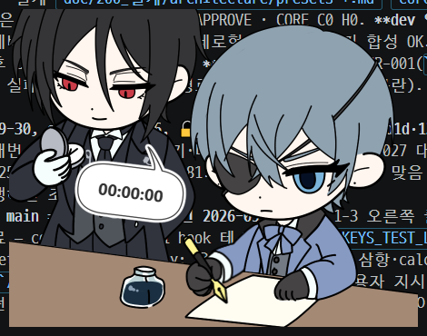
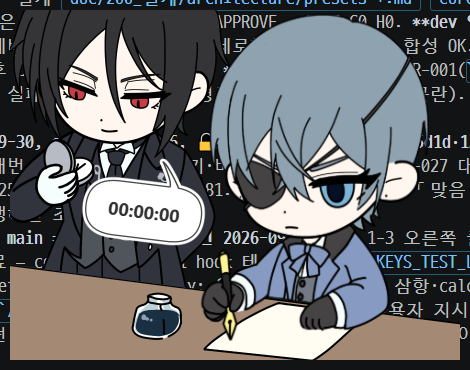
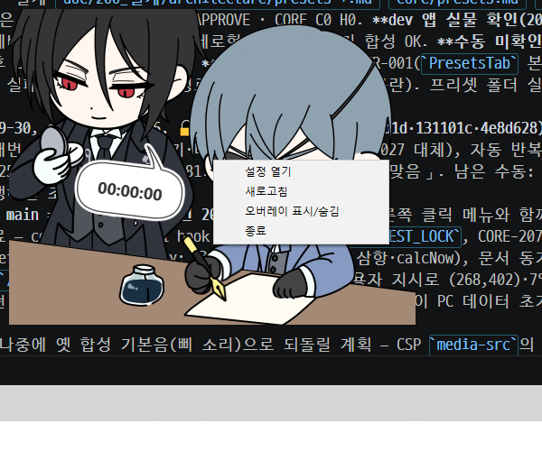
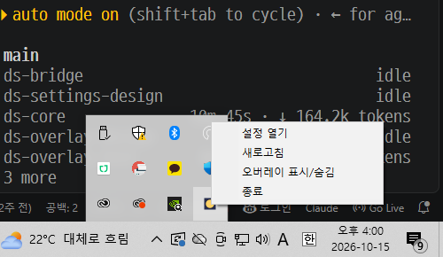

# 오버레이 사용 매뉴얼

화면에 떠 있는 캐릭터(오버레이)를 쓰는 방법을 설명합니다. 처음 쓰는 분도 순서대로 따라 하면 됩니다.

## 1. 개요

오버레이는 바탕 화면 위에 캐릭터 그림만 떠 있는 작은 창입니다. 키보드를 치거나 마우스를 움직이면 캐릭터가 그에 맞춰 바뀌고 통통 출렁입니다.

- 배경·테두리·그림자 없이 **내가 넣은 그림만** 보입니다.
- 다른 창 위에 항상 떠 있습니다. 게임이나 전체 화면 프로그램 위에도 올라옵니다.
- 오버레이에는 버튼이 없습니다. 그림은 설정 창에서 넣고, 오버레이에서는 옮기기와 크기 조절, 오른쪽 클릭 메뉴만 씁니다.
- 위 사진처럼 캐릭터 뒤로 다른 화면이 비쳐 보이는 것이 정상입니다.

## 2. 진입 경로

| 하고 싶은 일 | 방법 |
|---|---|
| 앱 켜기 | 앱(exe)을 실행합니다. 오버레이가 바로 뜹니다. |
| 메뉴 열기 | 캐릭터 위에서 **마우스 오른쪽 버튼**을 누르거나, 작업 표시줄 오른쪽 아래의 **트레이 아이콘**을 오른쪽 클릭합니다. |
| 설정 창 열기 | 메뉴의 **설정 열기**를 누릅니다. |
| 오버레이 숨기기·보이기 | 메뉴의 **오버레이 표시/숨김**을 누릅니다. |
| 앱 끝내기 | 메뉴의 **종료**를 누릅니다. |

트레이 아이콘이 안 보이면 작업 표시줄의 위쪽 화살표(숨겨진 아이콘)를 누르세요. 마우스를 올리면 `kuro_keyviewer`라고 표시됩니다.

## 3. 화면 구성

오버레이는 그림이 겹쳐 쌓인 모양입니다. 아래부터 위로 이렇게 쌓입니다.

| 순서(아래 → 위) | 내용 | 움직임 |
|---|---|---|
| 배경 | 책상 같은 바탕 그림 | 아무 반응 없이 그대로 |
| 뽀모도 인물·말풍선, 시간 글자 | 두 번째 캐릭터와 시계 | 시간만 바뀜 |
| 헤어(뒷머리) | 뒷머리 그림 | 몸과 함께 출렁임 |
| 마우스 팔 | 커서를 따라 움직이는 팔과 손 | 마우스를 따라감 |
| 몸통·키보드 그림 | 캐릭터 본체 | 키를 누르면 바뀜 |

- 그림은 설정 창에서 등록한 것만 나옵니다. 등록하지 않은 칸은 그냥 비어 있습니다.
- 기본 크기는 450×350 상자 안에 그림 비율을 지켜 맞춥니다. 창 크기는 그림 크기에 맞춰 저절로 바뀝니다.
- 이미지 규격(PNG 32bit, 최대 900×700, 1MB 이하 등)은 설정 창에서 그림을 넣을 때 안내됩니다.

## 4. 기능별 사용법

### 4.1 위치 옮기기

1. 캐릭터 위(투명한 부분도 포함)를 마우스 왼쪽 버튼으로 누른 채 끕니다.
2. 원하는 자리에서 놓습니다.

옮긴 위치는 저장되어, 앱을 다시 켜도 같은 자리에 뜹니다.

### 4.2 크기 바꾸기

- 오버레이 위에서 **Ctrl 키를 누른 채 마우스 휠**을 돌립니다. 크기는 25%에서 200% 사이입니다.
- 설정 창의 크기 슬라이더로도 바꿀 수 있습니다.

### 4.3 위치 잠금

설정 창에서 **위치 잠금**을 켜면 이렇게 바뀝니다.

- 캐릭터를 눌러도 클릭이 **뒤에 있는 창으로 그대로 전달**됩니다. 게임이나 채팅창을 그대로 쓸 수 있습니다.
- 끌어서 옮기기와 Ctrl+휠 크기 조절은 되지 않습니다. 크기는 설정 창에서 바꿉니다.
- 키보드·마우스에 반응하는 것은 그대로입니다.
- 잠금을 푸는 것은 설정 창에서만 합니다. 오른쪽 클릭 메뉴의 **설정 열기**로 갈 수 있습니다.

### 4.4 키보드에 반응하기

키를 누르면 캐릭터가 바뀌고, 떼면 원래대로 돌아옵니다.

- **새로 키를 누를 때마다** 캐릭터가 젤리처럼 탱글탱글 한 번 출렁입니다. 배경은 움직이지 않습니다.
- 키를 **꾹 누르고 있어서 글자가 계속 입력될 때**는 작고 빠르게 부르르 떨립니다. 키를 떼면 멈춥니다.
- 스페이스바, ㅋ(z), `?`, `!`, 엔터, 백스페이스, Ctrl+Z에는 **전용 그림**을 넣을 수 있습니다. 누르고 있는 동안 그 그림이 나옵니다. 전용 그림이 없으면 평소 누름 그림이 나옵니다.
- 어떤 글자를 쳤는지는 어디에도 저장되지 않습니다. 앱은 위 7가지 키인지 아닌지만 구분합니다.

### 4.5 마우스에 반응하기

마우스를 움직이면 마우스 팔이 어깨를 축으로 돌고 늘어나며 커서 쪽으로 손을 뻗습니다. 모니터가 여러 대여도, 커서가 있는 모니터 안에서 정해 둔 영역만큼 움직입니다. 움직이는 범위와 손의 시작 위치는 설정 창에서 정합니다.

- 마우스 **왼쪽·오른쪽 버튼**을 누르면 손이 클릭 그림으로 바뀝니다. 클릭 그림은 등록했을 때만 나옵니다.
- 마우스를 오래 움직이지 않으면 팔이 처음 자세(쉬는 위치)로 돌아갑니다.

### 4.6 펜 쥔 손

펜 쥔 손 그림을 넣고 설정 창에서 **펜 손 사용**을 켜면 이렇게 됩니다.

- 손은 팔 끝에 붙어 마우스를 따라다닙니다. 팔이 기울면 같이 기울고, 크기는 변하지 않습니다.
- 키를 치거나 마우스를 클릭하면 손 그림이 펜을 대는 그림으로 바뀌고 캐릭터가 출렁입니다. 위 사진이 클릭하는 순간입니다.
- 이때 몸통은 평소 그림 그대로입니다. 스페이스바·엔터 같은 특수 키를 누르는 동안에는 몸통도 그 키 전용 그림으로 바뀝니다.
- **펜 손 사용**을 끄면 손은 팔 끝을 따라다니기만 합니다. 키를 치면 몸통 그림이 바뀝니다.

### 4.7 대기와 쉬는 중

- 키를 치거나 마우스를 움직이거나 클릭하면 **대기** 상태입니다.
- **5분 동안** 아무 입력이 없으면 **쉬는 중**이 됩니다. 쉬는 중 그림을 등록했다면 그 그림이 나오고, 팔은 처음 자세로 돌아갑니다.
- 입력이 다시 들어오면 바로 대기로 돌아옵니다.
- 대기·쉬는 중 그림을 등록하지 않았다면 평소 키보드 그림이 그대로 보입니다.

### 4.8 뽀모도 시간 글자

두 번째 캐릭터의 말풍선 안에 시계(`00:00:00`)가 나옵니다. 위 전체 화면 사진의 말풍선이 그 모습입니다.

- **스톱워치**로 켜면 0부터 올라갑니다. **타이머**로 켜면 정해 둔 시간에서 0까지 내려갑니다.
- 시작·일시정지·멈춤은 설정 창이나 오른쪽 클릭 메뉴에서 합니다.
- 스톱워치는 쉬는 중이 되면 저절로 멈추고, 돌아와서 마우스나 키를 쓰면 이어서 흐릅니다. 직접 일시정지한 경우에는 저절로 이어지지 않습니다. 타이머는 쉬는 중에도 계속 줄어듭니다.
- 타이머가 0이 되면 `00:00:00`이 약 10초 동안 깜빡이고 **알림음이 한 번** 울립니다. 멈춤·시작을 누르거나 깜빡임이 끝나면 소리도 멈춥니다.
- 알림음과 음량은 설정 창에서 고릅니다. 고른 파일이 재생되지 않으면 기본 알림음이 대신 울립니다.
- 뽀모도 그림도 없고 시계도 꺼져 있으면 시간 글자는 보이지 않습니다.
- 앱을 다시 켜면 시간은 항상 `00:00:00`에서 시작합니다.

### 4.9 오른쪽 클릭 메뉴

캐릭터 위(투명한 부분도 포함)에서 마우스 오른쪽 버튼을 눌렀다 떼면, 커서 위치에 메뉴가 뜹니다. 작업 표시줄의 트레이 아이콘 메뉴와 **똑같은 메뉴**입니다.

| 항목 | 하는 일 |
|---|---|
| 설정 열기 | 설정 창을 엽니다. |
| 새로고침 | 오버레이를 다시 불러옵니다. 화면이 이상할 때 씁니다. |
| 오버레이 표시/숨김 | 오버레이를 숨기거나 다시 보이게 합니다. |
| 종료 | 앱을 끝냅니다. |

- 스톱워치나 타이머가 켜져 있으면 맨 위에 **시작**(흐르는 중이면 **일시정지**)과 **멈춤**이 더 붙습니다.
- 위치 잠금 중에도 뜹니다. 이때 오른쪽 클릭은 뒤에 있는 창에도 그대로 전달됩니다.
- **전체 화면 프로그램(게임·동영상 등)이 앞에 있으면 뜨지 않습니다.** 게임을 방해하지 않기 위해서입니다. 이럴 때는 트레이 아이콘을 쓰세요.
- 오버레이가 숨겨져 있으면 뜨지 않습니다.
- 메뉴가 뜨면 키보드 입력이 메뉴로 옮겨 갑니다. 메뉴를 닫아도 원래 창으로 자동으로 돌아가지 않으니 원래 창을 한 번 눌러 주세요.

### 4.10 트레이 아이콘 메뉴

작업 표시줄 오른쪽 아래 아이콘을 오른쪽 클릭하면 같은 메뉴가 뜹니다. 오버레이가 사라졌거나 전체 화면 중일 때는 이쪽을 씁니다.

### 4.11 다른 창 아래로 깔렸을 때

오버레이는 항상 맨 위에 있도록 되어 있습니다. 그래도 다른 프로그램이 위로 올라와 가려졌다면, **창을 한 번 전환**하면(작업 표시줄에서 다른 창을 누르거나 Alt+Tab) 다시 맨 위로 올라옵니다. 그래도 안 올라오면 메뉴의 **새로고침**을 누르세요.

## 5. 주의사항

- **같은 앱을 두 개 켜지 마세요.** 옛 버전이 켜져 있으면 새 버전이 뜨지 않을 수 있습니다. 먼저 옛 버전을 종료하세요.
- **관리자 권한으로 실행된 프로그램(일부 게임 등) 위에서는 키·마우스 반응이 없을 수 있습니다.** 그럴 때는 이 앱도 관리자 권한으로 실행하세요. 평소에는 관리자 권한이 필요 없습니다.
- 그림은 설정 창에서 넣습니다. 이미지 규격(PNG, 최대 900×700, 1MB 이하, 레이어끼리 같은 크기)을 지켜야 합니다.
- 입력한 글자 내용은 저장되지 않습니다. 키를 눌렀는지와 몇 가지 특수 키인지만 구분합니다.
- 오버레이 위치를 잠가 두면 끌어서 옮길 수 없습니다. 옮기려면 설정 창에서 잠금을 먼저 끄세요.

## 6. 자주 묻는 질문

**Q1. 게임 안에서는 캐릭터가 반응하지 않아요.**
게임이 관리자 권한으로 실행 중이면 일반 권한 앱은 키·마우스 입력을 받지 못합니다. 이 앱을 종료하고 **관리자 권한으로 다시 실행**하세요. 게임이 전체 화면(독점) 모드라면 창 모드 또는 테두리 없는 창 모드로 바꾸면 오버레이가 보입니다.

**Q2. 새 버전을 켰는데 화면에 아무것도 안 떠요. (옛 버전 0.1.0이 켜져 있어요)**
옛 버전이 이미 켜져 있으면 새 버전이 뜨지 않을 수 있습니다. 트레이 아이콘의 **종료**로 옛 버전을 끈 뒤 새 버전을 다시 실행하세요.

**Q3. 오버레이가 사라졌어요.**
1. 트레이 아이콘을 오른쪽 클릭해 **오버레이 표시/숨김**을 눌러 보세요. 숨김 상태였다면 다시 나타납니다.
2. 그래도 안 보이면 **새로고침**을 누르세요.
3. 설정 창에서 그림을 하나도 등록하지 않았거나, 크기를 너무 작게 줄여 둔 것은 아닌지 확인하세요.

**Q4. 다른 창에 가려졌어요.**
창을 한 번 전환하면 다시 맨 위로 올라옵니다. 그래도 안 되면 트레이 메뉴의 **새로고침**을 누르세요.

**Q5. 캐릭터를 끌어도 안 움직여요.**
위치 잠금이 켜져 있을 가능성이 큽니다. 오른쪽 클릭 메뉴의 **설정 열기**로 설정 창에 들어가 잠금을 끄세요. 잠금 중에는 Ctrl+휠 크기 조절도 되지 않습니다.

**Q6. 캐릭터를 눌렀더니 뒤에 있는 창이 눌려요.**
위치 잠금 중에는 클릭이 뒤에 있는 창으로 통과하도록 되어 있습니다. 정상 동작입니다.

**Q7. 오른쪽 클릭을 해도 메뉴가 안 떠요.**
전체 화면 프로그램이 앞에 있거나, 오버레이가 숨겨져 있거나, 오버레이 창 바깥을 눌렀을 때는 뜨지 않습니다. 트레이 아이콘의 메뉴를 쓰세요.

**Q8. 키를 쳐도 캐릭터 모양이 안 바뀌고 출렁이기만 해요.**
키를 누를 때 나올 그림(타자 입력 그림)을 등록하지 않았거나, 펜 손 사용이 켜져 있어서입니다. 펜 손이 켜져 있으면 몸통 그림은 그대로이고 손만 바뀝니다. 그림을 등록하는 방법은 설정 창에서 확인하세요.

**Q9. 마우스 손이 안 움직여요.**
마우스 팔 그림이 등록돼 있는지 확인하세요. 그림이 없으면 팔을 그리지 않습니다. 5분 넘게 입력이 없어 쉬는 중이 되어 처음 자세로 돌아가 있는 경우도 있습니다. 마우스를 움직이면 다시 따라옵니다.

**Q10. 시간 글자가 안 보여요.**
뽀모도 인물·말풍선 그림이 없고 스톱워치·타이머도 꺼져 있으면 시간 글자를 숨깁니다. 설정 창에서 시계를 켜거나 뽀모도 그림을 한 장 넣으세요.

**Q11. 타이머가 끝났는데 소리가 안 나요.**
설정 창의 알림음 음량이 0은 아닌지 확인하세요. 앱을 막 켠 직후 이미 끝나 있던 타이머는 소리가 나지 않습니다. 고른 알림음 파일이 재생되지 않으면 기본음이 대신 울립니다.

## 7. 관련 화면

- **설정 창** — 그림 등록, 배율, 위치 잠금, 마우스 팔 영역, 펜 손 사용, 뽀모도 타이머, 알림음, 자동 실행 설정. 오른쪽 클릭 메뉴나 트레이 메뉴의 **설정 열기**로 들어갑니다. (`src/settings/`)
