# 설정 창 사용 매뉴얼

캐릭터에 쓸 그림을 넣고, 크기·위치·시계·프리셋을 정하는 설정 창의 사용법입니다. 처음 쓰는 분도 위에서부터 순서대로 따라 하면 됩니다.

## 1. 개요

설정 창은 화면에 떠 있는 캐릭터(오버레이)와는 **따로 열리는 별도 창**입니다. 여기서 바꾼 내용은 바로 캐릭터에 반영됩니다. 따로 저장 버튼을 누를 필요가 없는 항목이 대부분입니다. 저장 버튼이 있는 곳은 해당 부분에서 따로 알려 드립니다.

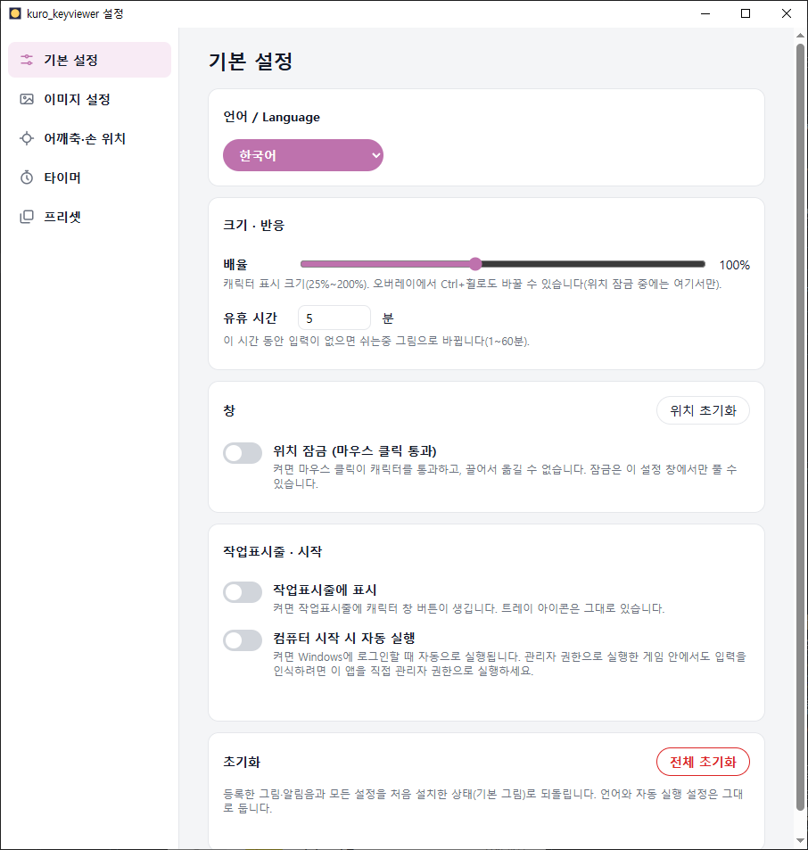

설정 창에서 할 수 있는 일은 다섯 가지입니다.

| 탭 | 하는 일 |
|---|---|
| 기본 설정 | 언어, 캐릭터 크기, 쉬는 시간, 위치 잠금, 작업표시줄 표시, 자동 실행, 전체 초기화 |
| 이미지 설정 | 캐릭터에 쓸 그림 등록·교체·되돌리기, 기본 이미지 내려받기 |
| 어깨축·손 위치 | 마우스 팔이 도는 중심(어깨축), 손이 움직이는 범위, 팔과 손의 자리 정하기 |
| 타이머 | 스톱워치·타이머, 알림음, 시간 글자의 위치·크기·색 |
| 프리셋 | 그림과 설정을 한 벌로 저장해 두고 골라 쓰기, 다른 PC로 주고받기 |

## 2. 진입 경로

설정 창은 아래 세 가지 방법으로 엽니다.

| 방법 | 순서 |
|---|---|
| 트레이 아이콘 메뉴 | 작업표시줄 오른쪽 아래 트레이 아이콘을 오른쪽 클릭 → **설정 열기** |
| 캐릭터 오른쪽 클릭 메뉴 | 화면의 캐릭터 위에서 마우스 오른쪽 버튼 → **설정 열기** |
| 앱을 한 번 더 실행 | 이미 켜져 있는 상태에서 앱(exe)을 다시 실행하면 새로 켜지지 않고 설정 창이 열립니다. |

- 트레이 아이콘이 안 보이면 작업표시줄의 위쪽 화살표(숨겨진 아이콘)를 눌러 보세요.
- 위치 잠금을 켜 두었거나 전체 화면 프로그램이 앞에 있을 때는 트레이 아이콘 메뉴를 쓰세요.
- 설정 창 제목 표시줄에는 `kuro_keyviewer 설정`이라고 표시됩니다. 창을 닫아도 앱은 꺼지지 않고, 캐릭터는 그대로 떠 있습니다.

## 3. 화면 구성

설정 창은 **왼쪽 메뉴**와 **오른쪽 내용 영역**으로 나뉩니다.

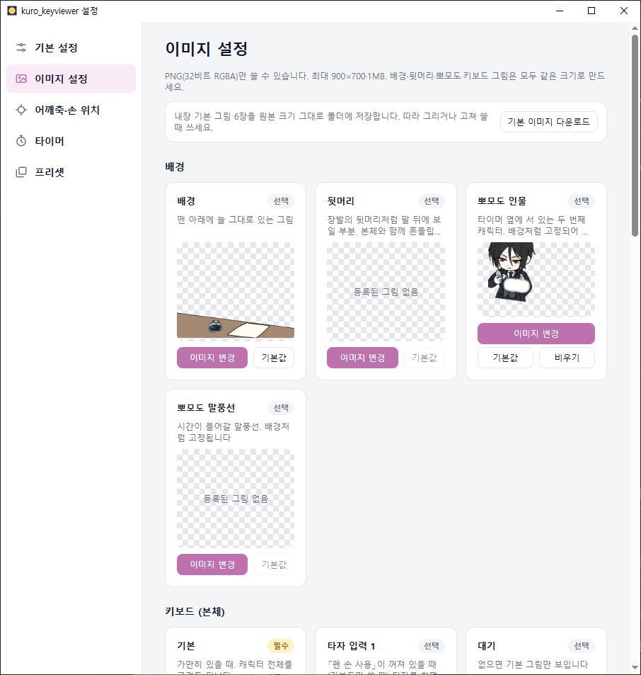

- **왼쪽 메뉴**: 위에서부터 기본 설정 · 이미지 설정 · 어깨축·손 위치 · 타이머 · 프리셋. 누르면 그 탭으로 바뀌고, 선택된 항목은 분홍색으로 표시됩니다. 키보드로는 위·아래 화살표로 옮깁니다.
- **내용 영역**: 맨 위 큰 제목이 지금 보고 있는 탭 이름입니다. 내용이 길면 마우스 휠로 아래로 넘깁니다.
- **오류 줄**: 뭔가 잘 안 됐을 때 제목 바로 아래에 연한 빨강 줄로 이유가 나옵니다. 「오류:」로 시작합니다.
- 흰 카드 하나가 설정 한 묶음입니다. 카드 제목과 설명을 읽고 아래의 버튼·스위치를 쓰면 됩니다.

## 4. 기능별 사용법

### 4.1 기본 설정 탭

위에서부터 카드 다섯 개가 있습니다.

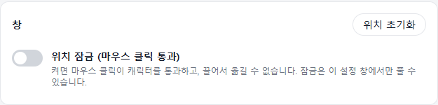

**언어 / Language**

- 한국어 · 日本語 · English 중에서 고릅니다. 고르면 설정 창 글자가 바로 바뀝니다. 앱을 다시 켜지 않아도 됩니다.
- 설정 창의 글자만 바뀝니다. 오버레이 화면은 달라지지 않습니다.

**크기 · 반응**

- **배율**: 슬라이더를 끌어 캐릭터 크기를 25%~200% 사이로 정합니다. 손을 놓는 순간 캐릭터 크기가 바뀝니다. 오버레이에서 Ctrl 키를 누른 채 마우스 휠로도 바꿀 수 있습니다. 위치 잠금 중에는 여기서만 바꿉니다.
- **유휴 시간**: 입력이 없을 때 「쉬는중」 그림으로 바뀌기까지의 분 수입니다. 1~60 사이의 정수를 적습니다. 범위를 벗어나면 「저장되지 않았습니다」라는 안내가 뜨고 값이 바뀌지 않습니다.

**창**

- **위치 초기화**: 캐릭터를 기본 자리로 되돌립니다. 확인 창 없이 바로 옮겨집니다.
- **위치 잠금 (마우스 클릭 통과)**: 스위치를 켜면 캐릭터를 눌러도 클릭이 뒤에 있는 창으로 그대로 전달되고, 끌어서 옮길 수도 없습니다. 게임이나 채팅 중에 캐릭터가 방해될 때 켭니다. 잠금은 이 설정 창에서만 풀 수 있습니다.

**작업표시줄 · 시작**

- **작업표시줄에 표시**: 켜면 작업표시줄에 캐릭터 창 버튼이 생깁니다. 트레이 아이콘은 그대로 있습니다.
- **컴퓨터 시작 시 자동 실행**: 켜면 Windows에 로그인할 때 앱이 저절로 켜집니다. 기본값은 꺼짐입니다. 누르면 「자동 실행 설정을 바꾸는 중입니다…」가 잠깐 보이고 끝나면 스위치가 바뀝니다. 별도의 허가 창은 뜨지 않습니다.

**초기화**

- **전체 초기화**: 등록한 그림·알림음과 모든 설정을 처음 설치한 상태로 되돌립니다. 확인 창이 한 번 뜨고, 「초기화」를 눌러야 실행됩니다. 되돌릴 수 없으니 신중하게 누르세요. 범위는 5장 주의사항과 FAQ에서 자세히 설명합니다.

### 4.2 이미지 설정 탭 (그림 등록하기)

캐릭터에 쓸 그림은 모두 여기서 넣습니다. 그림은 칸(카드)마다 하나씩 넣습니다.

**먼저 알아 둘 규격**

| 항목 | 규칙 |
|---|---|
| 파일 형식 | PNG, 32비트 RGBA만 가능합니다(투명한 배경이 있는 PNG). |
| 크기 | 가로 900 × 세로 700 이하 |
| 용량 | 파일 하나당 1MB 이하 |
| 같은 크기 | 배경 · 뒷머리 · 뽀모도로 인물 · 뽀모도로 말풍선 · 키보드 그림(기본, 타자 입력, 대기, 쉬는중, 특수 키)은 **모두 같은 크기**로 만들어야 합니다. 먼저 넣은 그림의 크기가 기준이 됩니다. |
| 자유 크기 | 팔(마우스)과 손(펜) 그림은 크기가 제각각이어도 됩니다. 위 상한만 지키면 됩니다. |
| 권장 | 900×700으로 만들면 가장 선명합니다. |

**카드 읽는 법**

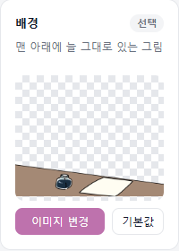

- 위쪽에 칸 이름과 **필수** 또는 **선택** 표시, 그 아래에 설명이 있습니다.
- 가운데 체크무늬 상자가 미리보기입니다. 비어 있으면 「등록된 그림 없음」이라고 나옵니다.
- **필수 그림은 두 장**입니다. 키보드 「기본」과 팔 「팔 기본」입니다. 나머지는 모두 선택입니다.

**그림 넣는 순서**

1. 넣고 싶은 칸의 **이미지 변경**을 누릅니다.
2. 파일 선택 창(제목 「PNG 이미지 선택」)에서 PNG 파일을 고릅니다.
3. 미리보기와 오버레이의 캐릭터가 바로 새 그림으로 바뀝니다.
4. 안 맞는 그림이면 그 카드 미리보기 아래 띠에 이유가 나옵니다. 다른 카드는 그대로입니다. 이유는 6장 FAQ에서 풀이합니다.

**그룹별 칸**

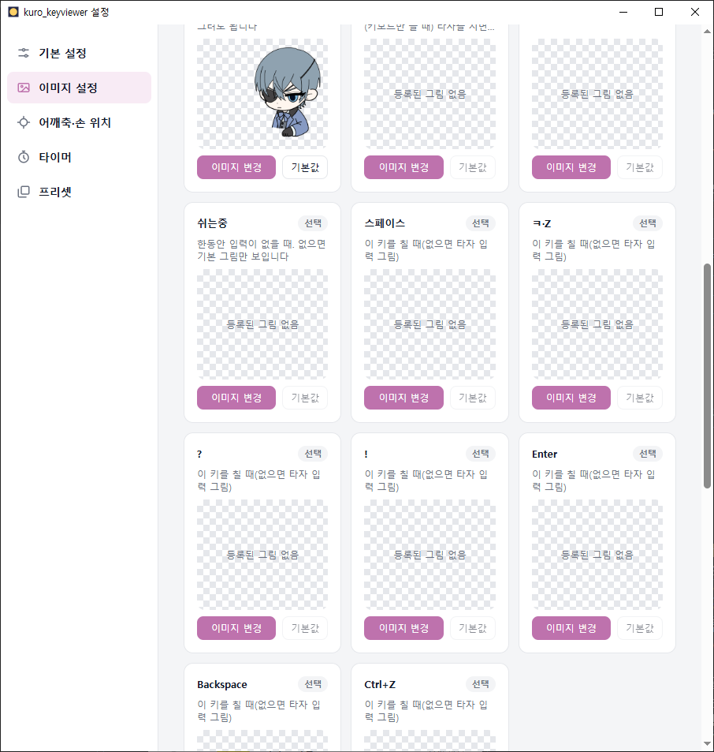

| 그룹 | 칸 | 설명 |
|---|---|---|
| 배경 | 배경 · 뒷머리 · 뽀모도로 인물 · 뽀모도로 말풍선 | 배경은 맨 아래에 늘 그대로 있는 그림입니다. 뒷머리는 팔 뒤에 보일 부분이고 본체와 함께 흔들립니다. 뽀모도로 인물과 말풍선은 타이머 옆의 두 번째 캐릭터와 시간이 들어갈 말풍선입니다. |
| 키보드 (본체) | 기본 · 타자 입력 · 대기 · 쉬는중 · 스페이스 · ㅋ·Z · ? · ! · Enter · Backspace · Ctrl+Z | 기본은 가만히 있을 때의 그림입니다. 「타자 입력」은 펜 손을 쓰지 않을 때 키를 치면 나옵니다. 스페이스부터 Ctrl+Z까지는 그 키를 누르는 동안 나오는 전용 그림이고, 없으면 타자 입력 그림이 나옵니다. |
| 팔 (마우스) | 팔 기본 · 왼클릭 · 오른클릭 | 마우스를 따라 움직이는 팔입니다. 왼클릭·오른클릭은 해당 버튼을 누르는 동안 나옵니다. |
| 손 (펜) | 손 기본 · 펜 입력 | 팔 끝에 붙는 펜 쥔 손입니다. 아래 「펜 손 사용」과 함께 씁니다. |

**「타자 입력」 그림 늘리기**

키보드 그룹 끝에 **+ 타자 입력 그림 추가** 카드가 있습니다. 누르면 칸이 하나 늘어나고, 여러 장이면 키를 칠 때마다 차례로 바뀝니다.

**펜 손 사용**

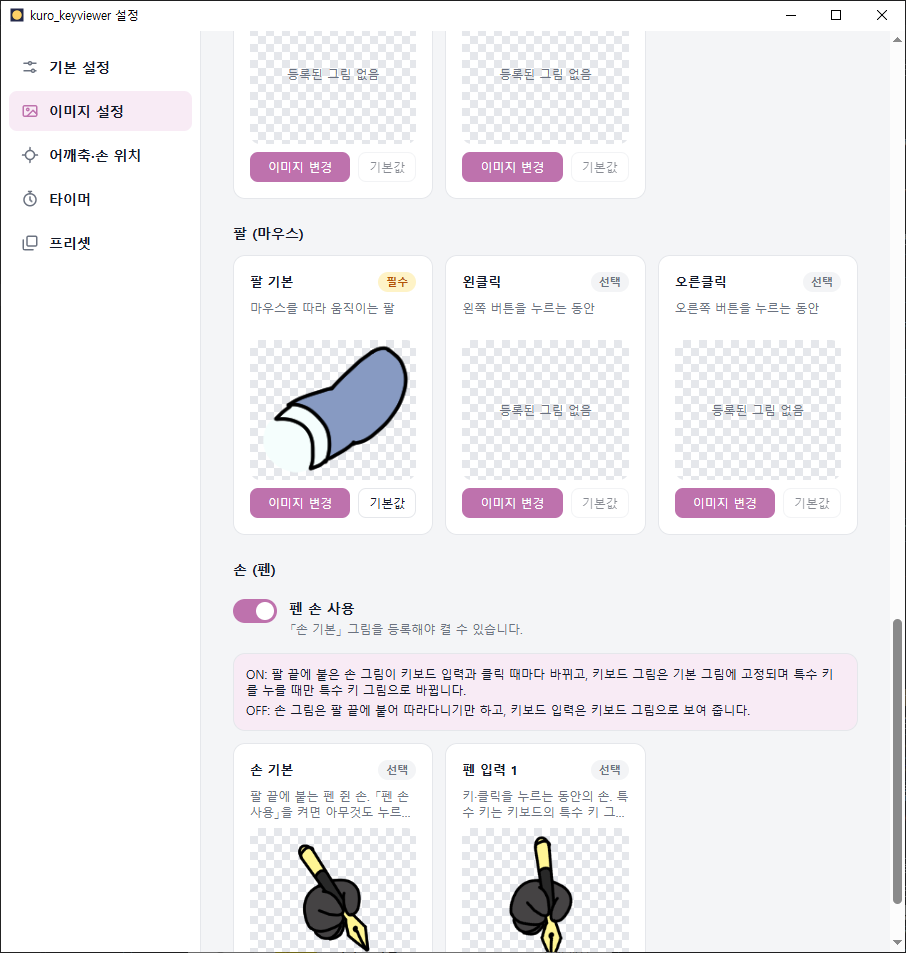

- 「손 기본」 그림을 등록해야 스위치를 켤 수 있습니다. 그림이 없으면 스위치가 꺼져 있고 눌러도 켜지지 않습니다.
- **켜면** 팔 끝에 붙은 손 그림이 키를 칠 때와 클릭할 때마다 바뀝니다. 키보드 그림은 기본 그림에 고정되고, 스페이스·Enter 같은 특수 키를 누를 때만 그 전용 그림으로 바뀝니다.
- **끄면** 손 그림은 팔 끝을 따라다니기만 하고, 키를 치면 키보드 그림이 바뀝니다.
- 켤 때는 확인 창이 뜹니다. 손 기본 그림을 처음 등록할 때도 「펜 손 모드를 켤까요?」 확인 창이 한 번 뜹니다.

**「기본값」과 「비우기」**

카드 아래 버튼의 동작은 칸마다 조금 다릅니다.

| 칸의 종류 | 「기본값」 | 「비우기」 |
|---|---|---|
| 처음 설치할 때 기본 그림이 들어 있는 칸(배경 · 기본 · 팔 기본 · 손 기본 · 펜 입력 · 뽀모도로 인물) | 기본 그림으로 되돌립니다. 지금 그림은 지워지고 되돌릴 수 없다는 확인 창이 뜹니다. 항상 누를 수 있습니다. | 뽀모도로 인물 카드에만 있습니다. 그림을 아예 비웁니다. |
| 기본 그림이 없는 칸(뒷머리, 대기, 쉬는중, 특수 키, 클릭 그림 등) | 등록한 그림을 지웁니다. 확인 창에서 「지우기」를 눌러야 합니다. 비어 있으면 흐리게 보이고 누를 수 없습니다. | 없습니다. |
| 타자 입력·펜 입력이 여러 장일 때 | 마지막 장부터 차례로만 지울 수 있습니다. 가운데 장은 흐리게 보이고, 마우스를 올리면 「마지막 장부터 지울 수 있습니다.」라고 나옵니다. | 없습니다. |

> 뒷머리는 처음 설치할 때 기본 그림이 없습니다. 비어 있는 것이 정상입니다.

**기본 이미지 다운로드**

탭 맨 위의 **기본 이미지 다운로드**를 누르면 앱에 들어 있는 기본 그림을 원본 크기 그대로 폴더에 저장해 줍니다. 따라 그리거나 고쳐서 쓸 때 편합니다.

1. 버튼을 누르고 저장할 폴더를 고릅니다.
2. 같은 이름의 파일이 이미 있으면 「같은 이름의 파일이 있습니다」 확인 창이 뜹니다. 덮어쓸지 정합니다. 덮어쓴 파일은 되돌릴 수 없습니다.
3. 끝나면 「기본 이미지 N장을 저장했습니다.」라고 나옵니다.

### 4.3 어깨축·손 위치 탭

마우스 팔을 어떻게 움직일지 정하는 탭입니다. 그림이 바뀌면 이 탭의 미리보기도 같이 바뀝니다. 팔 그림(필수)이 등록돼 있어야 합니다.

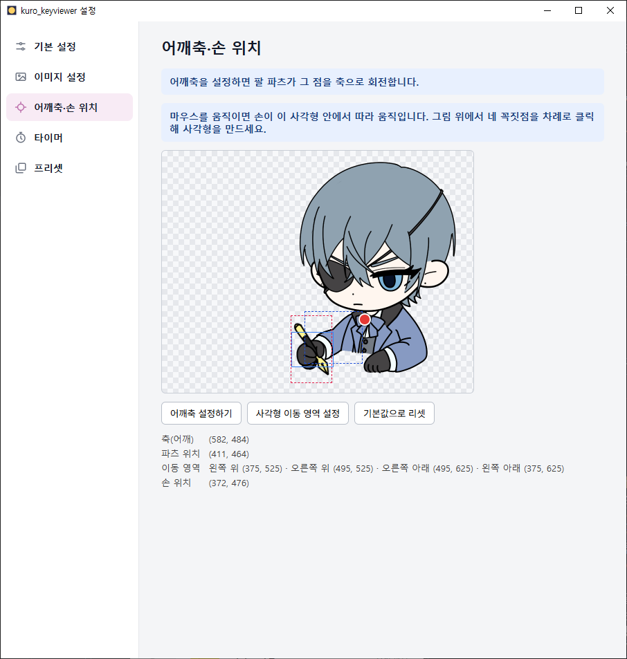

**미리보기 읽는 법**

- 바탕에 캐릭터와 팔, 펜 손 그림이 겹쳐 보입니다.
- **빨간 동그라미**가 어깨축입니다. 팔은 이 점을 중심으로 돌고 늘어납니다.
- **파란 사각형**이 이동 영역입니다. 마우스를 움직이면 손이 이 안에서 따라 움직입니다.
- 점선 상자는 팔과 손 그림이 차지하는 범위를 보여 줍니다.
- 미리보기 아래 글씨는 지금 값입니다. 「축(어깨)」 · 「파츠 위치」 · 「이동 영역」 · 「손 위치」가 나옵니다.

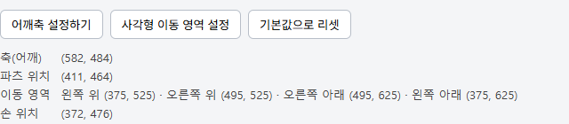

**① 어깨축 정하기**

1. **어깨축 설정하기**를 누릅니다. 안내가 「축이 될 부분을 마우스로 클릭해주세요.」로 바뀌고 미리보기에 파란 테두리가 생깁니다.
2. 미리보기에서 팔이 어깨에 붙는 관절 같은 부분을 한 번 클릭합니다.
3. 빨간 점이 찍히고 안내가 「축 위치를 확인하고 저장하세요.」로 바뀝니다.
4. 맞으면 **저장**, 다시 하려면 **취소**를 누릅니다. 저장하면 오버레이의 팔이 그 점을 중심으로 돕니다.

**② 이동 영역 정하기**

1. **사각형 이동 영역 설정**을 누릅니다.
2. 미리보기에서 네 꼭짓점을 순서대로 클릭합니다. 안내가 번호로 알려 줍니다.
   - 1/4 왼쪽 위 → 2/4 오른쪽 위 → 3/4 오른쪽 아래 → 4/4 왼쪽 아래
3. 네 점을 다 찍으면 「사각형이 맞는지 확인하고 저장하세요.」가 나옵니다. **저장**을 누릅니다. 취소하면 이전 영역이 그대로 남습니다.
4. 모니터가 여러 대여도 괜찮습니다. 마우스가 있는 모니터 안에서 화면의 위치 비율만큼 이 사각형 안을 움직입니다.

**③ 팔과 손의 자리 정하기 (끌어다 놓기)**

- 미리보기에서 **팔 그림이나 펜 손 그림을 마우스로 끌어서** 원하는 자리에 놓으면 그 자리가 저장됩니다. 끄는 동안 아래 「파츠 위치」·「손 위치」 숫자가 같이 바뀝니다.
- 눌린 자리에 실제로 그림이 그려져 있는 쪽이 움직입니다. 팔과 손이 겹친 곳은 위에 있는 손이 잡힙니다. 투명한 곳을 눌러서 끌면 아무것도 움직이지 않습니다.
- 그림이 미리보기 밖으로 나가지는 않습니다.
- 어깨축이나 이동 영역을 정하는 중에는 끌어다 놓기가 되지 않습니다. 먼저 끝내거나 취소하세요.

**④ 기본값으로 리셋**

어깨축, 이동 영역, 팔 위치, 손 위치를 처음 값으로 되돌립니다. 확인 창 없이 바로 적용됩니다. 「펜 손 사용」 스위치는 그대로 유지됩니다.

### 4.4 타이머 탭

캐릭터 옆 말풍선에 나오는 시계를 정하는 탭입니다. 시계는 스톱워치와 타이머 중 하나를 고르며, 둘 다 켤 수는 없습니다. 둘 다 꺼 둬도 됩니다.

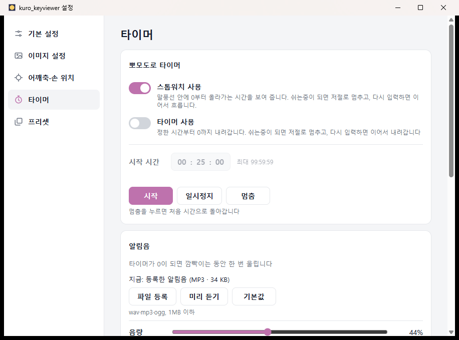

**뽀모도로 타이머 카드**

- **스톱워치 사용**: 켜면 `00:00:00`에서 시작해 올라갑니다. 쉬는중이 되면 저절로 멈추고, 다시 입력하면 이어서 흐릅니다.
- **타이머 사용**: 켜면 정해 둔 시간에서 0까지 내려갑니다. 쉬는중이 되면 저절로 멈추고, 다시 입력하면 이어서 내려갑니다.
- **시작 시간**: 타이머를 켰을 때 시·분·초 칸에 숫자를 적습니다. 처음 값은 `00:25:00`이고 `00:00:01`부터 `99:59:59`까지 가능합니다. 이 범위를 벗어나면 「00:00:01 ~ 99:59:59 사이로 입력해 주세요」가 나옵니다. 시계가 흐르는 중에는 바꿀 수 없고, 쉬는중 동안에도 잠겨 있습니다. 이때는 「멈춤 상태에서 바꿀 수 있습니다」라고 나옵니다.
- **시작 · 일시정지 · 멈춤**: 스톱워치나 타이머가 켜져 있을 때만 누를 수 있습니다. 멈춤을 누르면 처음 시간으로 돌아갑니다. 오버레이의 오른쪽 클릭 메뉴에서도 같은 조작을 할 수 있습니다.
- 타이머가 0이 되면 시간 글자가 약 10초 깜빡이고 알림음이 울립니다. 시작·멈춤을 누르거나 깜빡임이 끝나면 소리도 멈춥니다.

**알림음 카드**

- 처음에는 「지금: 기본 알림음」입니다.
- **파일 등록**: wav · mp3 · ogg 파일(1MB 이하)을 고릅니다. 등록하면 「지금: 등록한 알림음」으로 바뀝니다.
- **미리 듣기**: 지금 알림음을 한 번 들어 봅니다. 재생이 안 되면 「이 파일을 재생하지 못했습니다」가 나옵니다.
- **기본값**: 기본 알림음으로 되돌립니다. 이미 기본이면 흐리게 보입니다.
- **음량**: 슬라이더로 0~100%를 정합니다.

**시간 글자 카드**

- 미리보기에서 시간 글자를 **마우스로 끌어** 원하는 자리로 옮깁니다.
- 아래의 **회전**, **크기**, **글자 색**으로 모양을 정합니다.
- 뽀모도로 인물과 말풍선 그림은 이 탭이 아니라 이미지 설정 탭의 배경 그룹에서 넣습니다.
- 앱을 다시 켜면 시간은 항상 `00:00:00`(타이머는 정한 시간)에서 시작합니다.

### 4.5 프리셋 탭

프리셋은 게임의 캐릭터 선택처럼, **그림과 설정 한 벌을 이름 붙여 저장해 두고 골라 쓰는 기능**입니다. 다른 PC에서 만든 프리셋을 가져와 그대로 쓸 수도 있습니다.

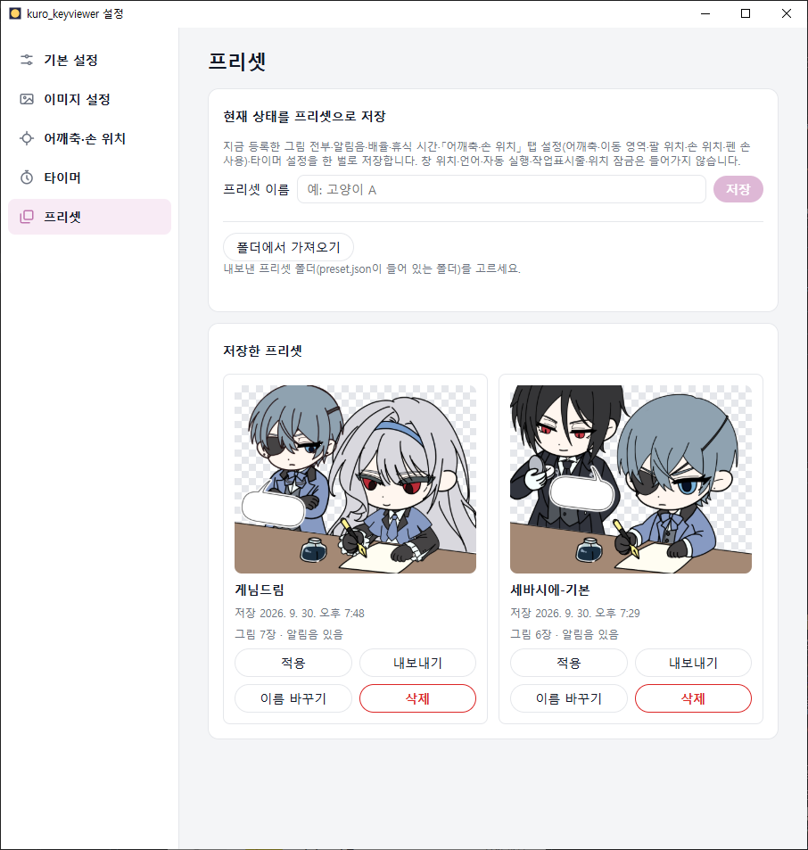

**프리셋에 들어가는 것과 안 들어가는 것**

| 들어갑니다 | 들어가지 않습니다 (PC마다 따로 정하는 설정) |
|---|---|
| 등록한 그림 전부, 알림음, 배율, 휴식 시간, 어깨축·이동 영역·팔 위치·손 위치·펜 손 사용, 타이머 설정 전체 | 창 위치, 언어, 자동 실행, 작업표시줄 표시, 위치 잠금 |

**현재 상태를 프리셋으로 저장**

1. 「프리셋 이름」 칸에 이름을 적습니다(1~50자, 예: 고양이 A).
2. **저장**을 누릅니다. 「「이름」 프리셋을 저장했습니다.」라고 나오고 아래 목록 맨 위에 새 카드가 생깁니다.
3. 키보드 「기본」 그림과 「팔 기본」 그림이 없으면 저장 버튼이 흐리게 보이고, 이유 안내가 나옵니다. 이미지 설정 탭에서 먼저 두 그림을 등록하세요.

**프리셋 카드**

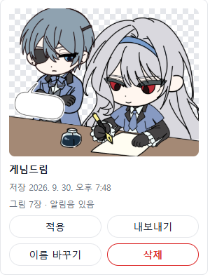

- 카드 위쪽 그림은 그 프리셋의 모습 미리보기입니다. 아래에 이름, 저장한 날짜, 그림 장수, 알림음 유무가 나옵니다.
- 목록은 최근에 저장한 것이 위에 옵니다.
- **적용**: 누르면 확인 창이 뜹니다. 「적용」을 누르면 지금의 그림·알림음·설정이 그 프리셋의 것으로 **통째로 바뀝니다.** 프리셋에 없는 그림 칸은 비워집니다. 지금 상태는 따로 남지 않으니, 남기고 싶으면 먼저 위에서 프리셋으로 저장해 두세요.
- **내보내기**: 프리셋을 폴더째 원하는 위치에 복사합니다. 같은 이름의 폴더가 이미 있으면 오류가 나므로 다른 위치를 고르세요. 압축은 직접 하면 됩니다.
- **이름 바꾸기**: 이름 입력 칸이 나오고, 새 이름을 적어 **저장**을 누릅니다.
- **삭제**: 확인 창에서 「삭제」를 누르면 지워지고 되돌릴 수 없습니다.

**폴더에서 가져오기**

1. **폴더에서 가져오기**를 누릅니다.
2. 내보낸 프리셋 폴더(`preset.json` 파일이 들어 있는 폴더)를 고릅니다.
3. 그림·알림음이 규격에 맞으면 목록에 추가됩니다. 하나라도 문제가 있으면 아무것도 추가하지 않고, 문제 있는 파일과 이유를 모두 보여 줍니다. 파일을 고친 뒤 다시 가져오세요.

**처음부터 들어 있는 프리셋**

앱을 처음 설치하면 기본 캐릭터 프리셋(「세바시에-기본」 등)이 이미 목록에 들어 있습니다. 배포판에 따라 들어 있는 프리셋 수가 다를 수 있습니다. 적용해 보면서 어떻게 쓰는지 살펴볼 수 있습니다. 지워도 괜찮습니다.

## 5. 주의사항

- **전체 초기화는 되돌릴 수 없습니다.** 등록한 그림·알림음과 모든 설정(배율·위치·타이머·어깨축 등)이 처음 상태로 돌아갑니다. 언어와 자동 실행 설정, 그리고 저장해 둔 프리셋은 그대로 남습니다. 오버레이는 기본 위치로 돌아갑니다.
- **프리셋 적용도 되돌릴 수 없습니다.** 지금 상태를 남기려면 적용 전에 프리셋으로 저장하세요.
- **같은 크기 규칙을 지키세요.** 배경·뒷머리·뽀모도로·키보드 그림은 모두 같은 크기여야 합니다. 팔·손 그림은 상관없습니다.
- **자동 실행은 일반 권한으로 실행됩니다.** 관리자 권한이 필요하지 않고 켤 때 허가 창도 뜨지 않습니다.
- **관리자 권한으로 실행된 프로그램(일부 게임 등) 안에서는 키·마우스에 반응하지 않을 수 있습니다.** 그럴 때는 이 앱을 직접 관리자 권한으로 실행하세요.
- **위치 잠금을 켜면** 캐릭터를 끌어 옮길 수 없고 Ctrl+휠도 안 됩니다. 크기는 설정 창에서 바꿉니다.
- 입력한 글자 내용은 저장되지 않습니다.

## 6. 자주 묻는 질문

**Q1. 그림을 넣었는데 거부돼요. 이유가 뭔가요?**
카드 아래 띠에 이유가 나옵니다. 흔한 경우는 이렇습니다.

| 나오는 문구 | 뜻과 해결 |
|---|---|
| PNG 파일이 아닙니다. / PNG 헤더가 손상되었습니다. | 확장자만 바꾼 파일이거나 깨진 파일입니다. 그림 프로그램에서 PNG로 다시 저장하세요. |
| 32비트 RGBA PNG만 쓸 수 있습니다(투명 배경 필요). | 투명 정보가 없는 PNG입니다. 투명 배경을 지원하는 형식으로 다시 저장하세요. |
| 이미지가 너무 큽니다. 최대 900×700입니다. | 가로나 세로가 900×700보다 큽니다. 줄여서 다시 넣으세요. |
| 파일 용량이 1MB를 넘습니다. | 파일이 큽니다. 크기를 줄이거나 압축한 PNG를 쓰세요. |
| 배경·뒷머리·뽀모도로·키보드 그림은 모두 같은 크기여야 합니다. | 이미 넣은 그림과 크기가 다릅니다. 같은 크기로 맞추세요. |

**Q2. 뒷머리 칸이 비어 있어요. 고장인가요?**
아닙니다. 뒷머리는 처음 설치할 때 기본 그림이 없는 칸입니다. 긴 머리 캐릭터처럼 팔 뒤에 보일 머리가 필요할 때만 직접 그림을 넣으세요. 넣은 그림을 지우고 싶으면 「기본값」을 누르고 확인 창에서 「지우기」를 누르면 됩니다.

**Q3. 프리셋 「저장」 버튼이 흐리게 보여서 눌리지 않아요.**
키보드 「기본」 그림과 「팔 기본」 그림이 둘 다 등록돼 있어야 저장할 수 있습니다. 이미지 설정 탭에서 두 그림을 먼저 넣으세요. 프리셋 이름 칸이 비어 있어도 저장되지 않습니다.

**Q4. 전체 초기화를 하면 뭐가 지워지나요?**
지워지는 것은 등록한 그림, 알림음, 그리고 배율·유휴 시간·위치 잠금·작업표시줄 표시·어깨축·타이머 설정 같은 모든 설정입니다. 기본 그림이 다시 채워집니다. 그대로 남는 것은 **언어, 자동 실행 설정, 저장해 둔 프리셋**입니다. 오버레이는 기본 위치로 돌아갑니다.

**Q5. 자동 실행을 켰는데 관리자 권한 허가 창이 안 떠요. 제대로 된 건가요?**
정상입니다. 자동 실행은 일반 권한으로 실행되도록 만들어져 있어 허가 창이 뜨지 않습니다. 관리자 권한으로 실행한 게임 안에서도 입력을 인식하게 하려면, 이 앱을 직접 관리자 권한으로 실행하세요.

**Q6. 「펜 손 사용」 스위치가 안 켜져요.**
「손 (펜)」 그룹의 「손 기본」 그림이 등록돼 있어야 켤 수 있습니다. 그림을 넣은 뒤 다시 켜 보세요.

**Q7. 마우스 손이 안 움직여요.**
먼저 「팔 기본」 그림이 있는지 확인하세요. 그림이 없으면 팔을 그리지 않습니다. 그림이 있는데도 이상하면 어깨축·손 위치 탭의 **기본값으로 리셋**을 눌러 보세요. 이동 영역이 너무 작게 잡혀 있어도 거의 안 움직여 보입니다.

**Q8. 그림을 끌어다 놓으려는데 안 움직여요.**
어깨축이나 이동 영역을 정하는 중이면 끌어다 놓기가 막힙니다. **저장** 또는 **취소**로 마친 뒤 해 보세요. 눌린 자리가 투명한 부분이면 아무것도 잡히지 않습니다. 그림이 그려진 부분을 누르세요.

**Q9. 캐릭터가 화면에서 사라졌어요 / 이상한 곳에 있어요.**
기본 설정 탭의 **위치 초기화**를 누르면 기본 자리로 돌아옵니다. 숨김 상태일 수도 있으니 트레이 아이콘 메뉴의 **오버레이 표시/숨김**도 확인하세요.

**Q10. 프리셋을 가져오는데 실패해요.**
오류 문구 아래에 문제 파일이 모두 나옵니다. 「프리셋 폴더가 아닙니다」라고 나오면 `preset.json`이 들어 있는 폴더를 다시 고르세요. 그림은 4.2에서 설명한 규격(PNG 32비트, 900×700 이하, 1MB 이하, 캔버스 그림은 같은 크기)을 지켜야 합니다. 고친 뒤 다시 가져오면 됩니다.

## 7. 관련 화면

- **오버레이** — 화면에 떠 있는 캐릭터. 키보드·마우스에 반응하고, 오른쪽 클릭하면 메뉴가 뜹니다. 위치 옮기기와 Ctrl+휠 크기 조절도 여기서 합니다. 사용법은 `src/overlay/manual.md`를 보세요.
